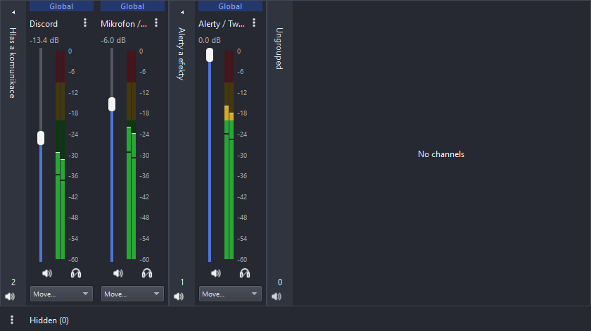
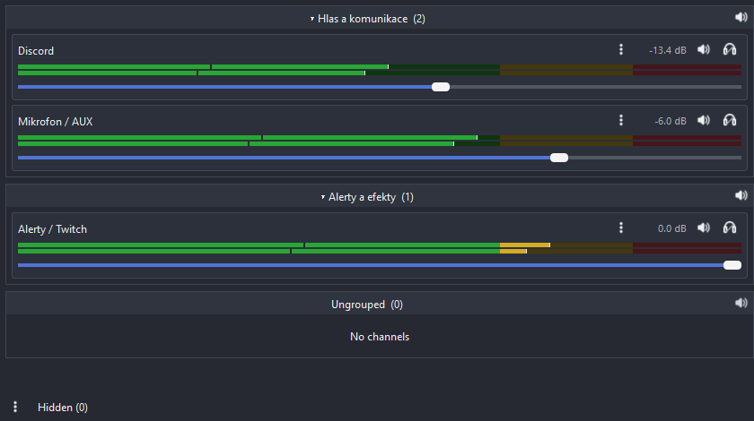

# Pecislav Sound Mixer

A native OBS Studio audio mixer dock with draggable channels, collapsible groups,
and two layouts. Built and tested for **OBS Studio 33.0.2 on Windows x64**.

**Created by [Pecislav](https://github.com/Pecislav).**

**[Download the Windows installer](https://github.com/Pecislav/pecislav-sound-mixer/releases/latest/download/Pecislav-Sound-Mixer-Setup.exe)**
· [All downloads](https://github.com/Pecislav/pecislav-sound-mixer/releases/latest)

[Český návod](README.cs.md) · [Build instructions](BUILDING.md) · [Changes](CHANGELOG.md)

Download names are stable and unnumbered. Maintenance updates replace the
current package instead of creating numbered release copies.



## Features

- Drag channels between groups, reorder them, or move them out to **Ungrouped**.
- Drag group headers to change their order, even while collapsed.
- Vertical channels expand groups to the right; compact rows expand downwards.
- Real OBS volume, mute, audio monitoring, and live meters.
- Meters use 16 ms redraws, OBS-style peak decay and VU integration, and the OBS profile's
  decay/peak-meter settings. This is custom rendering over libobs data.
- Hide channels without changing audio/routing; restore them using **Hidden**.
- Muted channels fade to gray without an overlay label covering the controls.
- Full source names are available in tooltips and context-menu headings.
- Open native source properties/filters and set volume, sync offset, balance,
  mono downmix and output tracks.
- Group order, membership, collapsed state, layout and hidden channels are saved
  per scene collection using stable source UUIDs.

The interface follows the **OBS language** when the plugin is loaded. Complete translations are included for Czech, English, Slovak, German and Polish; other OBS languages use English. It uses a dark appearance. Groups provide
organization and a shared mute action. They are not audio buses and do not have
group gain, group filters, nesting, custom hotkeys or Undo/Redo.

## Install

1. Download **[Pecislav-Sound-Mixer-Setup.exe](https://github.com/Pecislav/pecislav-sound-mixer/releases/latest/download/Pecislav-Sound-Mixer-Setup.exe)**.
2. Close OBS, launch the installer and approve its Windows elevation prompt.
3. Confirm the OBS installation folder. Setup checks for OBS 33.x and installs
   the plugin and locale data into the standard Windows OBS plugin location.
4. Start OBS and open **Docks → Sound Mixer** (the name follows your OBS language).

Setup registers an uninstaller in Windows Installed Apps. It does not modify
scenes, device settings or audio routing. The installer is currently unsigned.
Portable OBS users can use the ZIP/manual method below instead.

ZIP alternative: extract `Pecislav-Sound-Mixer-Windows-x64.zip`, close OBS,
and run `Instalovat.cmd`. A source/repository ZIP is not an installation package.

The installer copies the plugin to:

```text
C:\ProgramData\obs-studio\plugins\pecislav-group-mixer\
    pecislav-group-mixer.dll
    data\locale\...
```

It does not replace OBS files or edit scenes during installation. Existing plugin
DLLs are backed up before an update. Layout data from version 0.1.0 is supported.
The standard OBS mixer can remain enabled alongside this dock; both control the
same audio sources. Closing a group only hides its controls and does not mute it.

For manual installation, copy the archive's `pecislav-group-mixer` folder into
`C:\ProgramData\obs-studio\plugins`. For portable OBS, copy it into the portable
installation's `plugins` directory instead.

## Use

- Footer **⋮**: create a new group or change the layout.
- Drag a channel by its **name**, or use the move control below the channel.
- Drag a group by its header; right-click it to rename, move or remove it.
- **⋮** or right-click a channel: show its full name and available actions.
- Use a channel's menu to hide it. **Hidden (N)** restores hidden channels.
- Choose vertical channels or compact rows from the footer's layout menu.

Compact rows adapt to the dock width. Their meter and fader span the same width;
use the channel's **⋮** menu to move it between groups. Mouse-wheel scrolling
never changes volume; dragging the fader remains available. All meters show two
bars; mono sources mirror one measurement visually without changing their audio.

Deleting a group moves its channels to Ungrouped; it does not delete sources.
Hiding a channel changes only this dock's visibility. Audio, monitoring, gain,
track routing and group membership are preserved.



## Compatibility and testing

Windows x64 only. The supplied build targets OBS 33.0.2 and Qt 6.11.1; other OBS
major versions and Windows ARM64 need their own builds. Wider compatibility has
not been tested.

Tests cover group/channel order, layout migration, meter ballistics, real libobs
volume/mute changes, external volume synchronization, group drop events,
hide/restore without audio changes, mute animation, persistence, source removal
and scene-collection changes. A separate portable OBS test checks DLL loading
and dock registration; it is not a full end-to-end OBS startup test.

Screenshots use synthetic test audio sources. No microphone or desktop capture is
needed for the test suite.

## Build and contribute

See [BUILDING.md](BUILDING.md) and [CONTRIBUTING.md](CONTRIBUTING.md). The included
GitHub Actions workflow builds and uploads installation/source ZIPs as workflow
artifacts; it does not automatically publish a release.

## License

GNU General Public License v2 or later. See [LICENSE](LICENSE).
OBS Studio and Qt are separate projects and are not included in the installation package.
